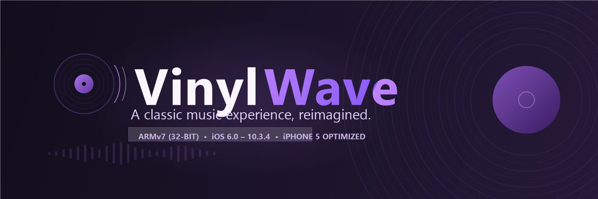
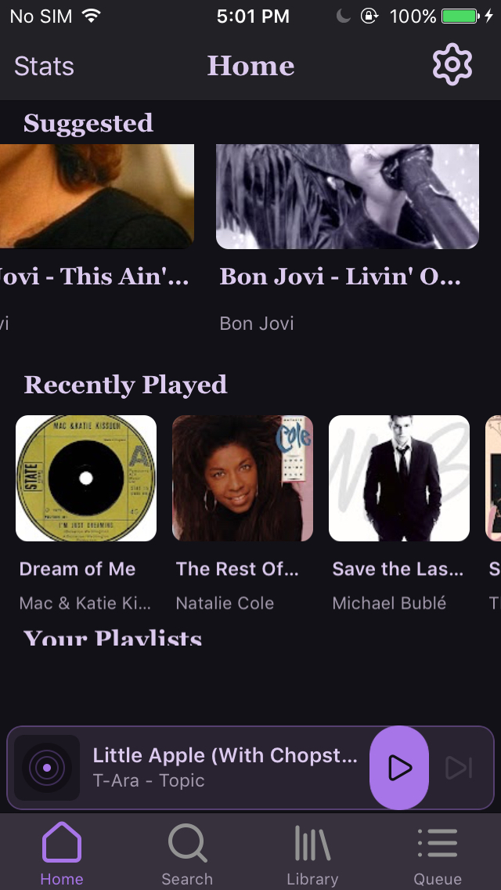
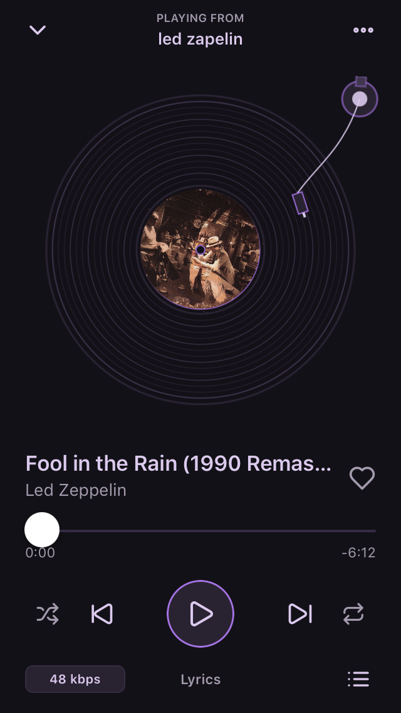
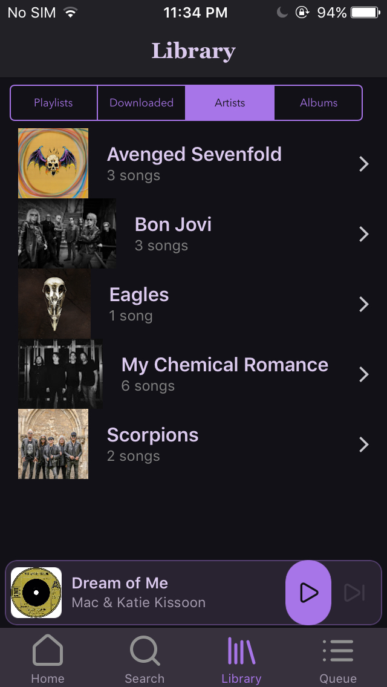
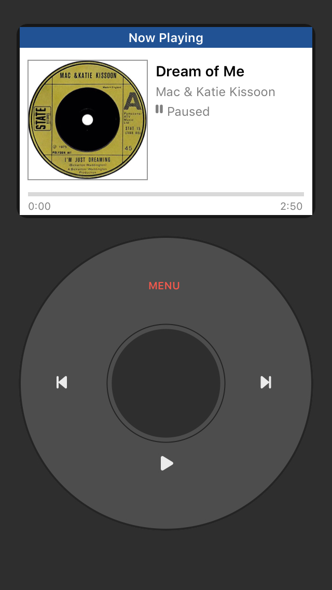
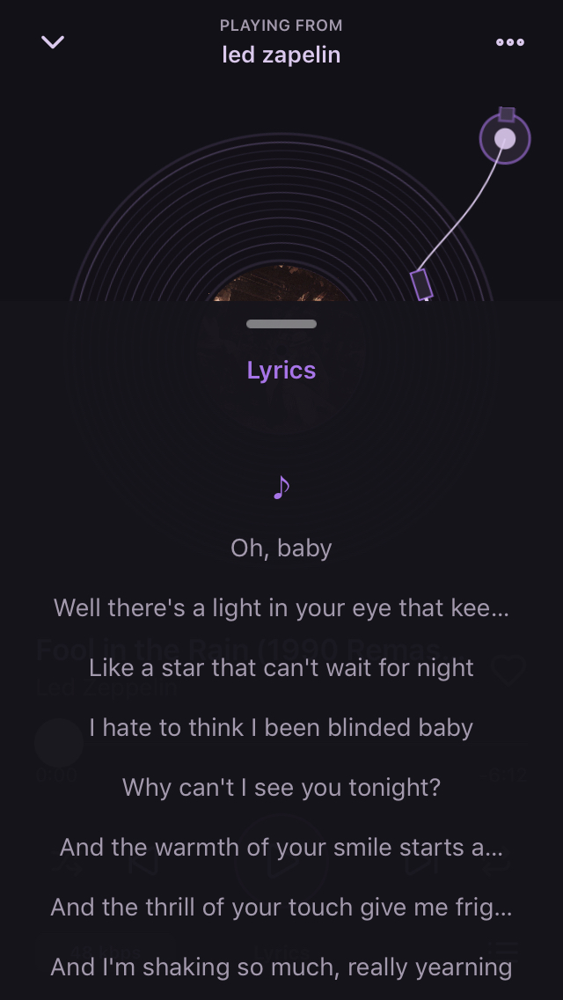

<div align="center">



<br/><br/>


# VinylWave

**A classic music experience, reimagined for legacy 32-bit iOS.**<br/>
*Retro vinyl-themed YouTube Music client custom-built for iPhone 5 & vintage Apple A6 devices.*

<br/>

[](https://github.com/ChopCho/VinylWave-Release/releases/tag/v1.0.0-beta1)
[](#supported-devices--compatibility)
[-orange.svg)](#supported-devices--compatibility)
[-7B2CBF.svg)](#supported-devices--compatibility)
[](LICENSE)
[](https://github.com/ChopCho/VinylWave-Release/releases/tag/v1.0.0-beta1)

<br/>

[**Overview**](#overview) • [**Download IPA**](#download-ipa) • [**Screenshots**](#screenshots) • [**Features**](#features) • [**Compatibility**](#supported-devices--compatibility) • [**Installation**](#installation) • [**Support the Project**](#support-the-project) • [**Disclaimers**](#legal--disclaimers)

</div>

<br/>

---

## Overview

**VinylWave** brings modern YouTube Music streaming to vintage 32-bit iOS devices. Built natively in Objective-C for the Apple A6 architecture, VinylWave pairs efficient low-latency audio playback with a nostalgic **Dark Plum** vinyl aesthetic.

Experience real-time spinning vinyl records, mechanical tonearm tracking, background audio playback with native lock screen controls, and an authentic classic iPod click-wheel navigation mode—all running smoothly on original hardware without webview bloat or sluggish runtimes.

---

## Download IPA

The official distribution format is a standalone sideloadable `.ipa` application package.

| Asset | Format | Architecture | Size | SHA-256 Checksum |
| :--- | :---: | :---: | :---: | :--- |
| [**VinylWave-iPhone5-armv7-v49-b14c.ipa**](https://github.com/ChopCho/VinylWave-Release/releases/download/v1.0.0-beta1/VinylWave-iPhone5-armv7-v49-b14c.ipa) | iOS App Binary | `armv7` (32-bit) | `2,543,866` B | `A8EF56196788B4DE698B528411E9721EC724BF3DF1BA9E49B807780EB807DCC0` |
| [**SHA256SUMS.txt**](https://github.com/ChopCho/VinylWave-Release/releases/download/v1.0.0-beta1/SHA256SUMS.txt) | Checksum Manifest | Manifest | `103` B | `12B26C20F0CF284C236E08EB5416B7B492B30128B648C17CEF28641193C26842` |

> [!TIP]
> Always verify the package integrity after downloading:
> ```bash
> sha256sum VinylWave-iPhone5-armv7-v49-b14c.ipa
> ```
> Expected: `A8EF56196788B4DE698B528411E9721EC724BF3DF1BA9E49B807780EB807DCC0`

---

## Screenshots

<div align="center">

| Home & Suggested | Now Playing Turntable | Library & Playlists |
| :---: | :---: | :---: |
|  |  |  |
| *Personalized recommendations & trending charts* | *Rotating vinyl record with mechanical tonearm* | *Local playlists and library collections* |

<br/>

| Classic iPod Mode | Synchronized Lyrics |
| :---: | :---: |
|  |  |
| *Retro skeuomorphic click-wheel navigation* | *Synchronized lyric sheet formatting* |

</div>

---

## Features

- **💽 Retro Vinyl Turntable UI:** Dynamic animated spinning vinyl record with rotating album art label, mechanical tonearm tracking, and fluid tactile playback controls.
- **🎵 Native Low-Latency Audio:** Built on native iOS audio frameworks with hardware-accelerated decoding optimized for Apple A6 processors.
- **📱 Background Streaming & Lock Screen Controls:** Uninterrupted playback with full lock screen player controls, scrubbable progress bar, and album artwork via `MPRemoteCommandCenter`.
- **🔍 Search & Discovery:** Fast query engine supporting Songs, Videos, Albums, and Artists with local query history caching.
- **🕹️ Classic iPod Mode:** Nostalgic skeuomorphic click-wheel interface with retro monochrome LCD navigation.
- **⚡ RAM-Conscious Architecture:** Engineered specifically within iOS 10 jetsam memory limits (~150 MB ceiling) to prevent memory crashes on 1 GB devices.
- **🛡️ Local-First & Private:** No Google account login required; library, playlists, and cached metadata persist locally on your device.

---

## Supported Devices & Compatibility

- **Target Device:** iPhone 5 (`iPhone5,1` / `iPhone5,2`), iPhone 5c (`iPhone5,3` / `iPhone5,4`), iPad (4th generation), iPod touch (5th generation).
- **Target Architecture:** Apple A6 / 32-bit ARMv7 (`armv7`).
- **Supported iOS Versions:** iOS 6.0 through iOS 10.3.4 (Optimized for iOS 10.3.4).

### Installation Prerequisites

- **AppSync Unified (Jailbroken Devices):**  
  Required when installing ad-hoc signed `.ipa` packages on jailbroken devices to prevent signature verification errors and certificate revocation. Install via Zebra or Cydia from Karen's Repo (`https://cydia.akemi.ai/`). If sideloading with a personal Apple ID profile (Sideloadly or AltStore), AppSync Unified is optional.
- **appinst (Command-Line IPA Installer):**  
  Package `ai.akemi.appinst` (by Karen/あけみ & Linus Yang, available via Zebra or Cydia from `https://cydia.akemi.ai/`). Provides native on-device command-line installation of downloaded `.ipa` files directly on jailbroken hardware (`appinst <path-to-ipa>`).

---

## Installation

VinylWave can be installed using several methods depending on your device setup:

1. **Computer Sideloading (Sideloadly / AltStore):**
   Connect your iPhone 5 via USB, drag `VinylWave-iPhone5-armv7-v49-b14c.ipa` into Sideloadly, sign with your Apple ID, and install.
2. **On-Device via appinst (Recommended for Jailbroken Devices):**
   Install `appinst` (`ai.akemi.appinst`) from Karen's Repo (`https://cydia.akemi.ai/`), download the IPA to your device, and run:
   ```bash
   appinst /var/mobile/Downloads/VinylWave-iPhone5-armv7-v49-b14c.ipa
   ```
3. **On-Device via Filza File Manager:**
   Download the IPA in Safari, open in Filza File Manager, tap the file, and select **Install** (requires AppSync Unified).

For complete walkthroughs, troubleshooting tips, and step-by-step guides, refer to [INSTALL.md](INSTALL.md).

---

## Known Limitations

- **Portrait-Only Layout:** Optimized for the 4.0-inch 640×1136 Retina display; landscape orientation is intentionally disabled.
- **Audio-Only Streaming:** Video streams are decoded for audio only to preserve memory and CPU headroom on vintage hardware.
- **Initial Buffer Latency:** Initial playback buffering may take 2–4 seconds depending on Wi-Fi or cellular network conditions.

---

## Support the Project

If you enjoy using VinylWave and would like to support the ongoing preservation and development of apps for legacy 32-bit iOS devices, voluntary contributions are deeply appreciated.

<div align="center">

<a href="https://sociabuzz.com/choppop/support">
  
</a>

<br/><br/>

[](https://sociabuzz.com/choppop/support)

<br/>

**Direct Link:** [https://sociabuzz.com/choppop/support](https://sociabuzz.com/choppop/support)

<br/>

*Support is completely voluntary and helps sustain hardware testing, maintenance, and software preservation for vintage iOS devices.*

</div>

---

## Legal & Disclaimers

- **Independent Project:** VinylWave is an independent project and is not affiliated with, endorsed by, or sponsored by Google LLC, YouTube, or Apple Inc.
- **Terms & Disclaimers:** Full legal disclaimers and terms of use are detailed in [DISCLAIMER.md](DISCLAIMER.md).
- **Third-Party Notices:** Font, icon, and component licenses are detailed in [THIRD_PARTY_NOTICES.md](THIRD_PARTY_NOTICES.md).
- **License:** Distributed under the terms of the [GNU General Public License v3.0 (GPLv3+)](LICENSE).
